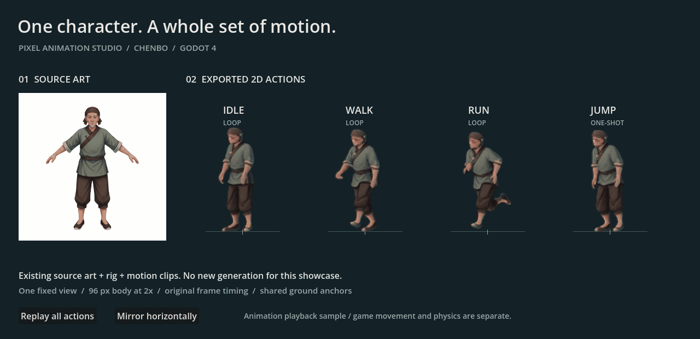
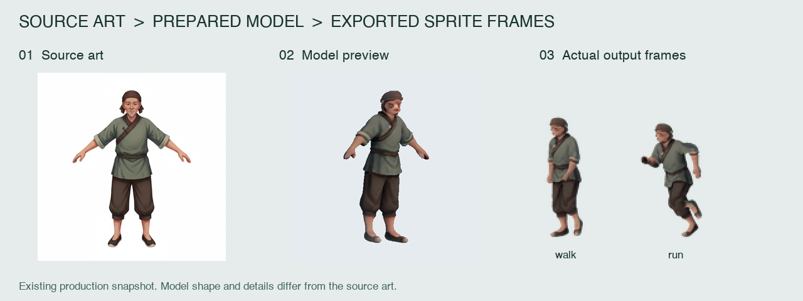

# Pixel Animation Studio

**让你的角色动起来，把素材带进游戏。**

从角色原画或已有模型出发，制作动作、渲染二维图集，再带着逐帧时序和脚底锚点接入 Godot。Pixel Animation Studio 把这些环节放进一个本地工作台，让独立开发者能够围绕同一个角色持续制作。



*现有角色「陈伯」：原画 → 模型与绑定 → 待机、行走、跑步、跳跃 → Godot 播放。动图录自仓库自带样例；人物按 2 倍显示，保留原始动作时序。*

[直接运行人物样例](examples/characters/chenbo) · [启动 Studio](#启动-studio) · [制作流程](docs/production-workflow.md) · [功能范围](docs/product-map.md)

## 一个角色，接下来能做什么？

有了角色原画，后面还有一整套工作：让模型能够运动，准备不同动作，保持渲染比例与视角一致，处理图集大小和播放时长，最后确认它在游戏里能用。

Studio 将这些工作串起来：

- **沿用同一个角色制作动作。** 原画重建或导入 GLB，准备模型，通过 Mixamo 辅助绑定、取得动作，再以统一视角渲染。绑定仍需人工摆点和检查。
- **把动作整理成一套。** 统一人物像素高度与配色，保留各帧时长，提供图集精简和整套预览。跳跃的运动范围和脚底定位随素材保存。
- **将成果交给游戏。** 导出 PNG 图集、Godot 场景、动作接口及接入说明。游戏可直接切换动作，不必重新猜测每张图的播放速度和原点。
- **制作中断后继续。** 保存任务和已有结果，在当前服务支持的范围内恢复；已完成的下载与渲染可以继续使用。

## 先试试现有成果

仓库包含一个可以直接打开的 [Godot 人物样例](examples/characters/chenbo)。**运行它只需 Godot 4，无需 Python、图片服务或重新生成素材。** 本次在 Godot 4.6.2 验证。

用 Godot 导入 `examples/characters/chenbo/project.godot`，运行后可查看四个动作、重新播放，以及水平镜像。命令行也可启动：

```bash
godot --headless --path examples/characters/chenbo --editor --import
godot --path examples/characters/chenbo
```



*上图使用现有原画、模型准备阶段的预览和实际导出帧。重建后的轮廓与细节存在变化，可以直接对照判断。来源与复现方法见[样例说明](examples/characters/chenbo/README.md)。*

样例中的人物场景可以复制到自己的 Godot 项目中：

```gdscript
var actor = preload("res://character_assets/character-50e87c3235/character.tscn").instantiate()
add_child(actor)
actor.play_action("run")
# 单次动作需要再次播放时，显式重启。
actor.play_action("jump", true)
```

样例保留一个固定视角；水平镜像用于左右翻转。人物移动、碰撞和游戏状态由接入工程实现。已检查动作、循环、逐帧时序、镜像锚点和单次播放结束行为；动作美术与循环接缝仍需按具体用途判断。

## 从人物，延伸到同一个游戏世界

Studio 也提供环境素材工作台：地表与过渡、道路、静态水体、独立物件、围栏构件和建筑。素材项目保存共同风格与规格，组合预览用于比较搭配，模块场景用于拼接和 Godot 接入验证。

我们正在用真实制作打磨这条流程：**设定共同参考 → 制作少量代表性素材 → 在目标镜头下组合 → 根据实际问题修正 → 再扩充套件。** 标准人高为 1，其他素材围绕它表达比例。

环境素材的整套稳定生产仍在验证中。共同提示词与参考图帮助约束输出，实际风格、结构和历史适用性需要查看结果并结合资料判断。各类素材的已实现能力与限制见[功能总览](docs/product-map.md)。

## 启动 Studio

在仓库根目录建立本地 Python 环境，安装静态素材工作台依赖：

```bash
python3 -m venv .local/python
.local/python/bin/python3 -m pip install Pillow numpy
./studio panel
```

打开终端打印的本机地址。先建立素材项目、设置共同风格与规格，再加入需要制作的素材。生成使用自行配置的图片服务；部分工作台支持直接导入图片。

人物原画重建、Mixamo 和渲染另有运行时与资源要求。首次配置请看[安装与服务配置](docs/getting-started.md)，已有成果的运行不需要重建这些依赖。

## 让 AI 也按项目要求制作

仓库提供 [studio-asset-production skill](skills/studio-asset-production/SKILL.md)，说明如何读取共同风格、提交参考图、使用 API 与数据格式、恢复任务、调整人高比例，并检查实际产出。它帮助 AI 沿用制作条件；视觉结果仍需看图和实际运行。

## 继续了解

| 想了解什么 | 从这里开始 |
| --- | --- |
| 为什么做 Studio，如何安排一轮制作 | [定位与制作总流程](docs/production-workflow.md) |
| 当前能制作哪些素材 | [项目与功能总览](docs/product-map.md) |
| 如何组织风格、需求与当前成果 | [素材项目](docs/studio-projects.md) |
| 如何制作建筑、拼接场景与处理碰撞 | [建筑](docs/building-pipeline.md) · [模块场景](docs/module-scene-mvp.md) · [碰撞](docs/collision-integration.md) |
| 图集、人物命令与底层实现细节 | [技术参考与历史说明](docs/technical-reference.md) |

工具代码位于 `pipeline/`，可运行人物样例位于 `examples/characters/chenbo/`。本机任务、用户原图和生成成果分别保存于 `.local/`、`workspaces/`、`deliverables/` 及各类 kits 目录，默认不进入版本库；展示样例是单独选入的成果快照。
