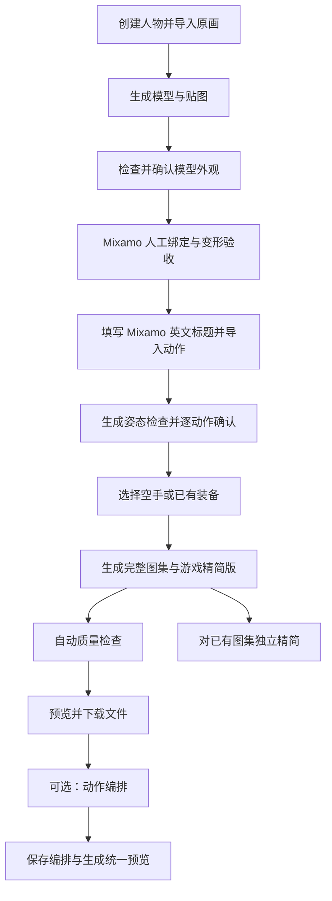

# Studio 流程与交互梳理

日期：2026-10-31。代码基线：`cb6f87b`。

本文基于现有面板、任务执行器和交付逻辑整理。以下为重构前的审查快照，保留问题依据。现已实现人物库与五页工作区，当前操作说明以 README 的「人物编辑器」为准。

## 1. 产品对象与边界

Studio 的目标是制作可用于游戏的人物资产。一个人物包含原画、模型、已验收绑定、原动作、装备设置、图集记录与编排。

| 对象 | 用户需要理解的含义 | 当前关联规则 |
| --- | --- | --- |
| 人物原画、模型 | 人物外观来源和重建结果 | 更换模型后需重新验收外观与绑定；历史交付保留 |
| 骨骼绑定 | 可供动作驱动的已验收人物 | Mixamo 人工摆点与变形验收；后续下载校验人物身份 |
| 原动作 | 从 Mixamo 下载的具体表演 | 保留英文标题；同名表演可有多个导入版本 |
| 动作导入批次 | 同次下载的动作集合 | 当前也是普通渲染的范围，批次内共享取景和调色板 |
| 独立武器 | 尚未与某个人物建立握持关系的模型 | 武器库可复用；需确认尺寸、朝向和握点 |
| 装备设置 | 某个人物持用某把武器的关系 | 跟随人物绑定版本，不跟随单个动作批次；相同绑定的新动作可复用 |
| 持用状态 | 武器何时在手中、背部、腰间或隐藏 | 人物装备默认值 + 按动作内容哈希保存的覆盖与事件 |
| 图集记录 | 某次设置下生成的固定结果 | 固定渲染器、取景、装备与时序；后来修改设置不改变旧记录 |
| 游戏精简版 | 图集记录的减少冗余帧版本 | 保持总时长，必须按逐帧时长播放；不是短循环提取 |
| 动作编排 | 多个动作的顺序、重复和速度 | 原动作重新统一取景后预览；保存编排与生成预览是两件事 |

人物装备与独立武器应保留区别。原动作、完整采样图集、游戏精简版也应保留区别；交互应清楚表达这些关系，而不是隐藏必要的专业概念。

## 2. 当前主流程

| 阶段 | 当前用户操作 | 当前结果与后续 |
| --- | --- | --- |
| 创建人物 | 名称、上传原画，然后点击生成 | 上传不等于生成；生成模型后仍需人工确认 |
| 外观确认 | 看多角度检查图，确认四肢、轮廓和背面 | 确认当前模型后开放绑定 |
| 绑定 | 打开 Mixamo，在外部浏览器摆点、检查变形、点击 Studio 确认 | 文件校验通过后才是可用绑定；点击确认不等于任务已完成 |
| 添加动作 | 到 Mixamo 选表演，返回 Studio 逐个填写原始英文标题并导入 | 身份、贴图、骨骼和动态轨道校验通过后，发布原动作批次 |
| 动作确认 | 生成姿态截图，逐个确认 | 确认的是动作与变形；还不是游戏图集的最终验收 |
| 渲染 | 在导出窗口选择同次导入动作、渲染器、尺寸、视角、装备 | 当前普通渲染处理整批，不是只处理左侧选中的动作 |
| 质量检查 | 看通过、需复核、失败；异常可定位至帧 | 普通批次发布合格动作并隔离失败项；编排要求整组通过 |
| 下载 | 动作属性下载单文件，导出窗口下载已有记录 ZIP | 游戏使用精简 PNG 时需携带时序；Godot 可直接使用对应 SpriteFrames |

## 3. 可选分支

### 武器与装备

1. 独立武器：上传武器原画、生成模型、检查八方向、设置长度和握点、确认。
2. 人物装备：选择武器和检查动作，打开 Godot 握持窗口调整握点、方向和大小，再验收保存。
3. 在装备页设置默认持用状态，必要时调整背部、腰间挂点。
4. 在动作页覆盖初始状态、添加百分比切换事件，并明确保存。
5. 重新生成图集才能看到新持用设置。已有图集继续展示生成时的装备快照。

装备是可选分支。新增动作不应要求重复做握持；更换人物绑定才需要重新复核。武器切换事件不会自动生成取剑、收剑的姿态。

### 独立精简

选择动作 → 选择已有渲染记录 → 生成此动作精简版，或精简同次导出的全部动作 → 完成后自动选中新记录 → 对照完整采样版并下载。

无需再下载或渲染。每次从完整图集开始；快速动作可能没有可合并帧。单个动作质量失败不阻止合格动作交付，全部失败时保留报告且不发布。

### 动作编排

选择已渲染动作 → 添加与调整片段顺序、重复、速度 → 保存编排 → 按统一渲染器、视角、尺寸和装备生成预览。

现有实现会回到原始 FBX 重新生成共享镜头的图集，不是直接拼接用户选中的成品图集。顺序、重复、速度变化可以复用统一预览；动作集合或渲染设置变化需要重新生成。编排暂不做骨骼过渡，也不导出合并图集或合并 GIF。

## 4. 当前交互中的主要断点

### P1：顶部引导与实际下一步脱节

`renderSetup` 主要检查模型和绑定；绑定就绪后长期显示“人物已就绪”和“添加动画”。已有待确认动作、渲染完成待复核、失败任务等状态没有成为顶部主操作。服务端已有 guidance，但当前前端顶部未使用它；服务端 guidance 也尚未完整覆盖精简和编排。

建议：顶栏针对当前选择对象给出一个主要操作，并附原因。例如“动作已导入 → 检查动作”“检查已完成 → 生成图集”“新结果已完成 → 查看结果”。任务正在等待用户时，直接显示去哪里完成什么操作。

### P1：当前设置与正在播放的结果容易被误认为同一份内容

动画预览来自某个历史图集的装备快照；右侧“此动作的武器状态”来自当前选定装备的可编辑设置。二者可能不同。保存设置有文字提醒，但缺少醒目的整体状态，用户容易认为设置没有生效或武器选择错乱。

建议：始终展示“正在预览：某次图集 / 某装备”和“当前设置：已保存 / 未保存 / 与此预览不同”。设置改变后给出“按当前设置重新生成”的明确操作。不要把旧图集的设置显示成实时编辑结果。

### P1：生成图集与下载文件共用“导出”入口

目前“导出…”同时承载生成任务、设置参数和下载历史 ZIP。已有图集的用户也会先看到新渲染参数，难以判断点击是否再次计算。

建议：把“生成图集”和“下载”分为明确操作。生成面向原动作；下载面向已生成记录。图集已存在时，下载应直接可达。

### P2：动作选择与批量范围不一致

左侧选中的是一个动作，渲染窗口处理的是同次导入整批；“精简全部”也限于同次导出。界面已列出范围，但用户仍需理解导入批次和导出记录的区别。

建议：执行前用动作清单和数量明确范围，文案为“生成这 3 个动作的图集”“精简这次输出的 3 个动作”。批次编号与来源时间放在展开信息中。后续是否支持任意动作集合，应独立评估统一取景需求，不在本轮直接改变渲染行为。

### P2：同名动作与多个图集记录需要两次辨认

“来源版本”区分原动作；“预览版本”区分其图集。图集记录目前主要显示时间、渲染器和武器，独立精简也会新增同样形式的记录，难以一眼判断是新渲染还是旧图集的精简派生。

建议：名称分别明确为“原动作来源”和“图集记录”。记录显示操作类型、渲染器、尺寸、视角、装备，以及完整/精简帧数。默认提供适用的最新记录，同时保留显式选择历史记录的能力。

### P2：保存行为不一致，切换页面的后果不够明确

原画上传和生成结果自动保存；持用设置要点击保存；武器确认会创建新版本；编排有浏览器草稿和显式保存。用户需要记忆每块区域的保存规则。持用表单改动后没有统一的未保存标记，切换资源或重建控件可能丢失本地编辑。

建议：对可编辑设置统一显示“未保存 / 已保存”；持用设置离开前保留草稿或给出处理入口。资产新版本与普通设置保存用不同提示。任务完成与美术确认也应分别表达，不能都显示“完成”后让用户猜测。

### P2：编排选择成品图集，却重新渲染原动作

选项显示图集的装备与渲染器，但最后使用编排自己的统一设置。用户可能期待完全复用选中成品的效果和精简结果。

建议：选入时明确说明“使用该记录对应的原动作”；编排统一设置显示为全段设置。“保存编排”与“生成预览”分别注明保存配置、运行计算的含义。已有原图集只提供来源依据，不能暗示直接拼接即可得到统一尺度。

## 5. 建议的页面职责

保持当前资源编辑器结构，先收敛信息与操作，不增加一套强制向导。

| 区域 | 单一主要职责 |
| --- | --- |
| 顶部 | 当前人物、当前任务或下一步；只突出一个与上下文相关的主要操作 |
| 左侧 | 人物模型、原动作、人物装备、武器库；编排作为独立工具入口 |
| 中央 | 清楚标明正在预览的对象与记录；完整/精简切换、播放和帧定位 |
| 右侧 | 对象属性与设置；保存状态；修改后如何生成新预览 |
| 图集记录区域 | 选择记录、查看参数、精简、下载；避免与原动作审批混在一起 |
| 底部任务区 | 当前阶段、等待用户的位置、错误与重试；详细日志作为展开项 |
| 质量检查 | 自动检查异常汇总与查看对应结果；明确自动通过仍需视觉验收 |

## 6. 建议落地顺序及验收

第一轮：明确当前上下文与下一步。

- 顶部引导与真实任务/动作状态一致。
- 持用设置显示未保存状态、与当前预览是否一致。
- 生成图集与下载文件有独立、可识别的入口。
- 验收：新增一个动作，用户能直接知道应检查还是生成；修改武器状态后能解释为何画面尚未变化。

第二轮：整理记录与批量范围。

- 统一原动作来源、图集记录、精简派生记录的命名与信息。
- 运行前明确本次处理的动作、装备与视角；运行后能直接查看结果。
- 验收：相同动作有两次导入、两种渲染器和一次精简时，能准确选择、下载需要的版本。

第三轮：整理编排交互。

- 明确从原动作生成统一预览，不把选中的历史图集当成最终全段效果。
- 保存、重新生成、可复用预览的状态明确。
- 验收：只改顺序或速度无需重新渲染；更换动作集合或全段装备后明确提示重新生成。

本轮先建立以上交互规范，再改界面；不扩展场景、角色控制或自动短循环识别。
